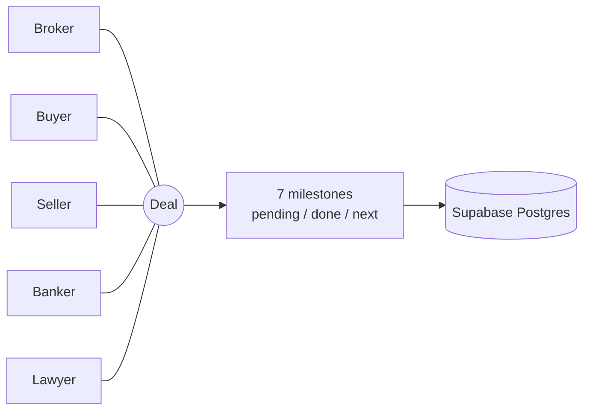

# Property Passport

**A live iOS and Android app for running property resale deals.** It replaces the WhatsApp groups and paper trails
that independent property brokers in Maharashtra use today.
→ [Get it on Google Play](https://play.google.com/store/apps/details?id=com.planstalk.propertypassport)

> The source code is private. This page describes the product and how it works. I'm happy to walk through the code
> in an interview.

## The problem

A resale deal involves five parties: broker, buyer, seller, banker and lawyer. Today they coordinate through chat
groups and paper, so nobody knows what is done, what is pending, or who is holding things up.

## How it works

The app models a resale deal as a **7-stage milestone workflow**. Each party sees the same deal from their side:
what is pending, what is done and what comes next.

## What I built

- The app, end to end, and shipped it to Google Play
- The deal model: milestones, the five roles, and what each role sees
- The backend on Supabase (Postgres)

## Stack

React Native (Expo) · TypeScript · Supabase (Postgres)
